  

  
  
  
  
  
  
  
  
  
  

  

  

### `$ git log --graph --all`

  <picture>
    <source media="(prefers-color-scheme: dark)" srcset="https://raw.githubusercontent.com/freco-dev/freco-dev/output/snake-dark.svg" />
    <source media="(prefers-color-scheme: light)" srcset="https://raw.githubusercontent.com/freco-dev/freco-dev/output/snake.svg" />
    
  </picture>

### `$ gh stats --user freco-dev`

  
  

  

<code>exit 0</code>

